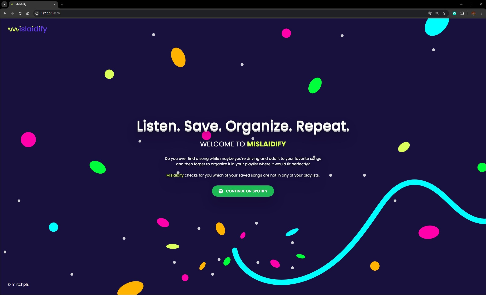
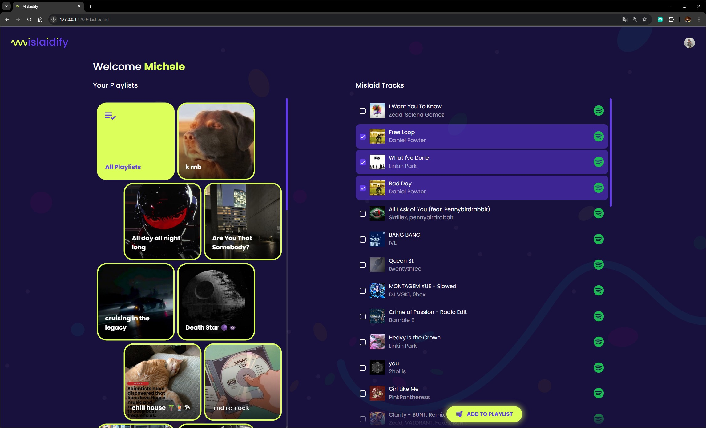

# Mislaidify

> [!NOTE]
> This project is no longer maintained. Spotify now grants [production API access](https://developer.spotify.com/documentation/web-api/concepts/quota-modes) only to registered businesses with a large user base, and limits personal apps to development mode: up to 5 users, with Spotify Premium required for the app owner.

> Listen. Save. Organize. Repeat.

Mislaidify finds the saved Spotify songs that are not in any of your playlists.

The idea came from a personal habit: finding great songs while driving, saving them to Spotify, and then never getting around to organizing them into playlists. Over time they'd just pile up — forgotten somewhere in a library of over 8000 saved tracks. Mislaidify solves exactly that: it scans your saved songs and surfaces the ones that haven't been added to any playlist yet, so nothing gets lost in the pile.

Built with Angular 19 and Tailwind CSS.

## Screenshots





## Getting started

### 1. Create a Spotify app

Go to the [Spotify Developer Dashboard](https://developer.spotify.com/dashboard) and log in with your Spotify account.

Click **Create app** and fill in the form:

| Field | Value |
|---|---|
| App name | Mislaidify (or anything you prefer) |
| App description | Any short description |
| Website | Leave blank |
| Redirect URIs | `http://127.0.0.1:4200/dashboard` |
| Which API/SDKs are you planning to use? | Web API |

Accept the terms and click **Save**.

### 2. Copy your Client ID

Open the app you just created and click **Settings**. Copy the **Client ID** shown at the top.

### 3. Add the Client ID to the project

Open `src/environments/environment.ts` and replace the existing `clientId` value with yours:

```ts
export const environment = {
  clientId: 'your-client-id-here',
  ...
};
```

### 4. Install dependencies and run

```bash
npm install
```

## Scripts

| Command | Description |
|---|---|
| `npm start` | Starts the Angular dev server at `http://127.0.0.1:4200` |
| `npm run build` | Builds the app for production |
| `npm run watch` | Builds in watch mode (development) |
| `npm test` | Runs unit tests (single run) |
| `npm run test:watch` | Runs unit tests in watch mode |
| `npm run test:coverage` | Runs unit tests with coverage report |

## Development

The app authenticates directly against the Spotify OAuth flow. On first load, the user is redirected to Spotify to authorize the app. After authorization, the SDK stores the access token locally and the dashboard loads the user's playlists and saved tracks.

Spotify OAuth requires the redirect URI to be registered in your [Spotify Developer Dashboard](https://developer.spotify.com/dashboard).

## Roadmap

- **Mobile UX**: The dashboard is desktop-first with two side-by-side columns. On mobile, the plan would be to switch to a tab-based navigation: a first tab to select playlists, a second tab to browse mislaid tracks. On desktop the layout remains unchanged. This is currently low priority — since the app won't be publicly released, the only likely users are technical people running it locally, almost certainly on desktop.
- Replace scrollbars with fade on items into view while scrolling
- Possibility to create a new playlist when selecting where to add selected songs
